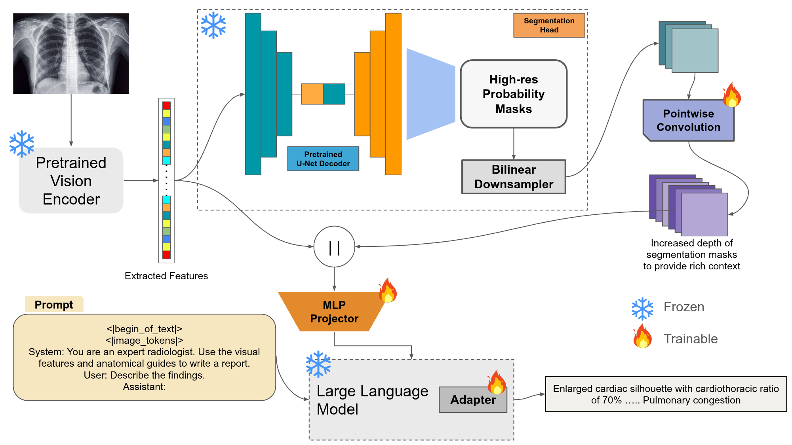

# Radixpert: A Staged Adaptation and Hierarchical Fusion Framework for Radiology VLMs



Radixpert is a vision-language model for **radiology report generation**. It starts from
`meta-llama/Llama-3.2-11B-Vision-Instruct` and adds two components:

- **MSA-LoRA (Multi-Stage Adaptive LoRA):** low-rank adapters whose rank, scaling and behaviour change across
  three training stages.
- **HCF (Hierarchical Cross-Modal Fusion):** a stack of cross-attention fusion levels, with adaptive gating, that
  combines image features and text embeddings before they reach the language model.

It is trained on **ROCO v2** (about 15,000 samples) and **PadChest** (about 16,000 samples).
Reported results (see the paper): BLEU-4 0.194, CIDEr 0.478, RadCliQ-v1 0.823.

[](https://assets.tina.io/1fb09d03-9237-4c49-aaa9-d024a83c7ac7/Radixpert__A_Staged_Adaptation_and_Hierarchical_Fusion_Framework_for_Radiology_VLMs.pdf)

> For a module-by-module description see [`docs/ARCHITECTURE.md`](docs/ARCHITECTURE.md).

---

## Contents

1. [Repository layout](#repository-layout)
2. [Installation](#installation)
3. [Data](#data)
4. [Training](#training)
5. [Evaluation](#evaluation)
6. [Inference](#inference)
7. [How the method works](#how-the-method-works)
8. [Configuration reference](#configuration-reference)
9. [Known limitations](#known-limitations)
10. [Citation](#citation)

---

## Repository layout

```
config/       Dataclass configs (TrainingConfig, StageConfig) and YAML export
data/         Dataset classes (PadChest, ROCO v2), preprocessing, augmentation, multi-stage loaders
models/       Radixpert model, MSA-LoRA layers, HCF fusion, vision encoder
training/     Multi-stage trainer, loss functions, optimizers and LR schedulers
evaluation/   Report-generation metrics (BLEU, ROUGE, CIDEr, METEOR, BERTScore, entity F1, RadCliQ-style)
scripts/      Command-line entry points: prepare_data, train, evaluate, inference
utils/        Checkpointing, logging, device/memory helpers, visualization
assets/       Architecture diagram
```

## Installation

Requires Python 3 with PyTorch 2.x and a CUDA GPU for training (the base model has 11B parameters).

```bash
git clone https://github.com/AreebAhmad-02/Radixpertv2.git
cd Radixpertv2
pip install -r requirements.txt
python -m spacy download en_core_web_sm   # used by the entity-overlap metric
```

You also need access to the gated Llama weights. Accept the licence on Hugging Face, then log in:

```bash
huggingface-cli login
```

`flash-attn` and `deepspeed` are listed in `requirements.txt` but are optional. Remove them if they fail to
build on your machine.

## Data

Radixpert uses two public datasets. Neither is included in this repository.

| Dataset | Used for | Expected files under the root you pass in |
| --- | --- | --- |
| **ROCO v2** | Stages 1–3 | `roco-dataset.json` (or a CSV with the same fields) and an `images/` folder |
| **PadChest** | Stages 2–3 | `PADCHEST_chest_x_ray_images_labels_160K_01.02.19.csv` and an `images-64/` folder |

File and folder names are the defaults in `data/datasets.py` (`create_roco_config`, `create_padchest_config`).

**What each sample contains**

- ROCO v2: image plus text built from the `anatomy`, `keywords` and `caption` fields
  (`ANATOMY: … . KEYWORDS: … . CAPTION: …`). Samples with fewer than 3 caption words are dropped.
- PadChest: image plus text built from `Labels` and `Report` (`FINDINGS: … . REPORT: …`). Rows with an empty report
  are skipped.
- Images are resized to 512×512 with optional medical preprocessing (intensity normalisation, CLAHE, contrast
  enhancement, noise reduction). Text is cleaned, abbreviations are normalised, and Spanish PadChest keywords are
  translated. Reports are tokenised to at most 512 tokens.
- Each dataset is split 80% / 10% / 10% into train / val / test by the dataset classes.

**Pre-processing.** The dataset classes apply image and text pre-processing on the fly, so you can train directly
from the raw dataset folders. `scripts/prepare_data.py` is an additional utility for validating images and writing
cleaned annotation files and statistics (see [Known limitations](#known-limitations)).

## Training

Training runs in **three stages**, one after the other, in a single command:

| Stage | Name | Data | Language model | Purpose |
| --- | --- | --- | --- | --- |
| 1 | Pre-alignment | ROCO v2 | frozen (LoRA only) | Align image features with the language model |
| 2 | Domain adaptation | ROCO v2 + PadChest | frozen (LoRA only) | Adapt to chest X-ray reports |
| 3 | Task-specific | ROCO v2 + PadChest | unfrozen | Fine-tune for report generation |

The vision encoder and the HCF fusion module are trainable in every stage.

```bash
python scripts/train.py \
    --padchest_root /data/padchest \
    --roco_root /data/roco_v2 \
    --output_dir ./radixpert_experiments/run1
```

Per-stage settings are given as three values, one per stage:

```bash
python scripts/train.py \
    --padchest_root /data/padchest \
    --roco_root /data/roco_v2 \
    --output_dir ./radixpert_experiments/high_lr \
    --stages "1,2,3" \
    --batch_size 4 \
    --num_epochs 15 20 25 \
    --learning_rate 1e-4 5e-5 2e-5 \
    --lora_rank 16 24 32 \
    --mixed_precision \
    --use_sam \
    --wandb_project "radixpert-ablation"
```

`--num_epochs`, `--learning_rate` and `--lora_rank` each take exactly three values (stage 1, 2, 3). They are **not** a
hyperparameter sweep.

Resume from the latest checkpoint in the output directory, or from a specific file:

```bash
python scripts/train.py --padchest_root /data/padchest --roco_root /data/roco_v2 \
    --output_dir ./radixpert_experiments/run1 --auto_resume

python scripts/train.py ... --resume_from ./radixpert_experiments/run1/stage_2_final.pt
```

**All `train.py` options**

| Option | Default | Meaning |
| --- | --- | --- |
| `--padchest_root`, `--roco_root` | required | Dataset roots |
| `--model_name` | `meta-llama/Llama-3.2-11B-Vision-Instruct` | Base language model |
| `--vision_backbone` | `efficientnet_b7` | One of `efficientnet_b7`, `resnet50`, `vit_base`, `swin_transformer` (the encoder also supports `densenet121`) |
| `--output_dir` | `./radixpert_training` | Checkpoints, logs and metrics |
| `--stages` | `1,2,3` | Stages to run |
| `--batch_size` | 8 | Training batch size (same for all stages) |
| `--num_epochs` | `10 15 20` | Epochs for stages 1, 2, 3 |
| `--learning_rate` | `5e-5 3e-5 1e-5` | Learning rate for stages 1, 2, 3 |
| `--lora_rank` | `8 12 16` | LoRA rank for stages 1, 2, 3 |
| `--eval_every_n`, `--save_every_n` | 2, 5 | Evaluation and checkpoint frequency |
| `--max_eval_samples` | 1000 | Samples used in the final evaluation |
| `--mixed_precision` | off | Mixed-precision training |
| `--gradient_checkpointing` | off | Trade compute for memory |
| `--use_sam` | off | Sharpness-Aware Minimization (not the Segment Anything Model) |
| `--use_lookahead` | off | Lookahead optimizer wrapper |
| `--compile_model` | off | `torch.compile` the model |
| `--wandb_project`, `--wandb_entity`, `--no_wandb` | `radixpert`, none | Weights & Biases logging |
| `--config` | none | YAML/JSON file whose keys fill any option not set on the command line |
| `--auto_resume`, `--resume_from` | off | Resume training |
| `--num_workers`, `--log_level` | 4, `INFO` | Data loader workers, logging |

Outputs written to `--output_dir`: a log file, `stage_<n>_final.pt` after each stage, periodic checkpoints,
`emergency_checkpoint.pt` if you interrupt with Ctrl+C, and `final_evaluation_metrics.json`.

## Evaluation

```bash
python scripts/evaluate.py \
    --model_path ./radixpert_experiments/run1/stage_3_final.pt \
    --data_root /data \
    --dataset_type both \
    --split test \
    --save_predictions
```

Useful options: `--max_samples`, `--batch_size`, `--num_beams`, `--temperature`, `--max_length`,
`--save_visualizations` (attention maps) and `--output_dir`.

**Metrics** (`evaluation/metrics.py`): BLEU-4, ROUGE-1/2/L, CIDEr, METEOR, BERTScore, a clinical-entity overlap F1,
a keyword-based clinical accuracy score, and a RadCliQ-style composite.

The entity-overlap F1 and the RadCliQ-style composite in this repository are **simplified approximations**:
entities come from spaCy plus a fixed anatomy/pathology keyword list, and the composite is an equal-weight average
of BLEU-4, BERTScore, embedding similarity and entity F1, converted with `1 / (1 + x)`. They are intended for
tracking training and are not drop-in replacements for the official RadGraph and CheXbert-based RadCliQ.

## Inference

```bash
# One image
python scripts/inference.py \
    --model_path ./radixpert_experiments/run1/stage_3_final.pt \
    --image_path ./example_cxr.png \
    --save_formatted

# A folder of images
python scripts/inference.py \
    --model_path ./radixpert_experiments/run1/stage_3_final.pt \
    --image_dir ./images --batch_mode --batch_size 8
```

Options: `--prompt` (optional text such as `"FINDINGS: "` to guide generation), `--max_length` (512),
`--temperature` (0.7), `--num_beams` (4), `--device` (`auto`, `cuda`, `cpu`, `mps`), `--return_confidence`,
`--output_dir`. Results are written as JSON (`single_inference_result.json` or `batch_inference_results.json`).

Radixpert generates draft text for research. It is not a medical device and its output must not be used for
clinical decisions.

## How the method works

**Pipeline.** An image goes through the vision encoder. The resulting features and the text embeddings from the
language model are combined by the HCF module. The fused features are passed to the language model as input
embeddings, and the model generates the report with beam search.

**Vision encoder** (`models/vision_encoder.py`). A selectable CNN or transformer backbone with medical
preprocessing, multi-scale feature extraction, spatial and channel attention, and 2-D positional encoding.

**HCF fusion** (`models/hcf_fusion.py`). Three hierarchical fusion levels (16 attention heads, 4096-d fusion space).
Each level uses cross-modal attention between vision and text features. An adaptive gate controls how much of each
modality passes through, a small MLP combines the levels, and an auxiliary "clinical validator" head scores the
fused features.

**MSA-LoRA** (`models/msa_lora.py`). LoRA adapters are attached to the attention and MLP projections
(`q_proj`, `k_proj`, `v_proj`, `o_proj`, `gate_proj`, `up_proj`, `down_proj`). With base rank `r`:

| Stage | Adapter rank | Scaling | Behaviour |
| --- | --- | --- | --- |
| 1 | `max(4, r // 4)` | × 0.5 | adapter output additionally scaled by 0.1 |
| 2 | `max(8, r // 2)` | × 0.8 | batch normalisation applied to the adapter output |
| 3 | `r` | × 1.0 | learnable sigmoid gate on the adapter output |

The layer also supports L2 and orthogonality regularisation on the adapter weights.

**Loss** (`training/losses.py`). A weighted sum of generation loss (label-smoothed cross-entropy), a contrastive
vision–text loss, a clinical-validation loss, a fusion regulariser and LoRA regularisation. The weights depend on
the stage:

| Stage | generation | contrastive | clinical | fusion | regularization | msa_lora |
| --- | --- | --- | --- | --- | --- | --- |
| 1 | 1.0 | 0.5 | 0.0 | 0.0 | 0.1 | 0.1 |
| 2 | 1.0 | 0.7 | 0.3 | 0.2 | 0.1 | 0.15 |
| 3 | 1.0 | 0.8 | 0.5 | 0.3 | 0.1 | 0.2 |

**Special tokens.** The tokenizer is extended with report-structure tokens such as `<FINDING>`, `<IMPRESSION>`,
`<ANATOMY>`, `<PATHOLOGY>`, `<NORMAL>` and `<ABNORMAL>`.

**Optimisation** (`training/optimization.py`). AdamW with stage-specific betas, cosine schedule with warm restarts,
gradient clipping at 1.0, optional mixed precision, SAM and Lookahead.

## Configuration reference

- `config/training_config.py` defines `TrainingConfig` (paths, image size 512×512, text length 512, base model,
  backbone, fusion layers, output directory, mixed precision, W&B settings) and `StageConfig` (per-stage batch
  size, epochs, learning rate, weight decay, LoRA rank and alpha). `create_stage_configs` builds the three stages
  from lists; `save_config_to_file` writes the settings to YAML.
- `models/radixpert.py` defines `RadixpertConfig` (LoRA rank/alpha/dropout and target modules, fusion layers and
  dimensions, stage, freezing flags, maximum report length).

## Known limitations

- Training was run on a single dataset pair (ROCO v2 and PadChest); results on other scanners, hospitals or
  report styles are untested.
- No pretrained checkpoints are released.
- Inference and evaluation need the full 11B base model and a GPU with enough memory.
- The metrics noted above are approximations of the published ones.
- No automated tests are included yet.
- `scripts/prepare_data.py` is a work in progress: its command-line parser is not finished, so use the dataset
  classes' built-in pre-processing instead.

## Citation

```bibtex
@inproceedings{farooqi2025radixpert,
  title     = {Radixpert: A Multimodal Approach to Medical Imaging},
  author    = {Farooqi, M. A. R. and Chaudhry, Areeb Ahmad and Ghaffar, M. Y. and Perwaiz, N. and Kiani, H. M.},
  booktitle = {IEEE International Conference on Frontiers of Information Technology (FIT)},
  year      = {2025}
}
```
